# Explainable Reinforcement Learning for Autonomous Navigation

### Interpreting Agent Decisions through Attention and Saliency-Based Analysis

**Tutorial Project Report, Team GHAR**\
Hitansh Jain (1MS23CS073), Rishi Dargad (1MS23CS047), Gunveer Kalsi (1MS23CS070), Adityavikram (1MS23CS014)\
Department of Computer Science and Engineering, M S Ramaiah Institute of Technology, Bengaluru

---

## Abstract

We train reinforcement learning (RL) agents to navigate a robot to a goal while avoiding obstacles in a
PyBullet simulation exposed through the Gymnasium API, and we build an interpretability layer that
explains every decision. Agents trained with PPO (MLP and attention policies, discrete and continuous
control) and DQN reach 97 to 100% success on training layouts. On unseen, denser held-out layouts the
attention policy generalises best (92% held-out success over 1 seed), against 72% for the PPO MLP policy over three
seeds and 53% for a classical potential-field controller. The interpretability layer combines an
attention policy that is interpretable by design with five post-hoc saliency methods, exact Shapley
values over eleven semantic input groups, global feature analysis, partial dependence, and a distilled
decision tree. Unlike most XRL demonstrations, we also test the explanations: a deletion test shows that
Integrated Gradients, occlusion and group Shapley identify inputs whose removal changes the decision
three to four times more than random removal, while a model-randomisation sanity check shows that those
same methods are largely driven by the input itself (rank correlation about 0.8 with a randomly
initialised network). Explanations expose a consistent strategy (steer by goal heading, brake and
turn on the front 120 degrees of lidar) and explain the main failure mode: in a U-shaped trap every
agent keeps turning toward the goal into a dead end.

---

## 1. Introduction

Deep RL policies are learned functions from sensor readings to actions. They can work well, but a
navigation policy that fails in deployment gives no account of why. Explainable RL (XRL) aims to show
which parts of the input drove a decision so that a human can debug, audit and calibrate trust in the
agent.

This project follows the proposal submitted earlier:

1. Build a simulated navigation environment with Gym and PyBullet (obstacles, start, goal).
2. Train RL agents (PPO, DQN) to reach the goal without collisions.
3. Evaluate with success rate, episode reward, path efficiency and collision frequency.
4. Build an interpretability layer using attention and saliency.
5. Perform feature-level analysis (obstacle distance, heading angle, ...).
6. Visualise navigation together with explanations so decisions can be reviewed.
7. Analyse representative and unexpected decisions to judge whether explanations are useful.

Two choices go beyond the proposal and shape the results. First, we evaluate generalisation on a
held-out layout distribution and on five hand-designed scenarios, not just on training-style maps.
Second, we evaluate the explanations themselves (faithfulness and sanity checks), because saliency maps
that look plausible are not evidence on their own.

## 2. System design

```
                 +-------------------------------+
                 |  NavEnv (Gymnasium API)       |
  layouts.py --> |  PyBullet world: walls,       |  obs (29)   +--------------------------+
  train/heldout  |  boxes, cylinders, robot,     | ----------> | Policy (SB3)             |
  scenarios      |  rayTestBatch lidar,          |             |  PPO-MLP / PPO-Attention |
                 |  getClosestPoints collision   | <---------- |  DQN-MLP / PPO-cont      |
                 +-------------------------------+   action    +------------+-------------+
                          |  episodes                                       | PolicyModel (differentiable)
                          v                                                 v
                 eval/metrics.py                         explain/  saliency | shapley | attention
                 success, collisions, reward,                      feature analysis | surrogate tree
                 A*-style path efficiency                          faithfulness | decision mining
                          |                                                 |
                          +---------------------> viz/ <--------------------+
                                     plots, annotated GIF/MP4, interactive replay.html
```

The code is a Python package, `xrl_nav`, with five modules (`envs`, `agents`, `eval`, `explain`, `viz`)
and four command line scripts (`train.py`, `evaluate.py`, `explain.py`, `demo.py`). All settings are in
`configs/default.yaml`, and `scripts/run_all.sh` reproduces every number in this report. A `pytest`
suite (15 tests) checks the environment geometry, determinism, solvability of generated layouts, and the
mathematical properties of the explanations (Integrated Gradients completeness, Shapley efficiency).

## 3. Simulation environment

**World.** A 10 m x 10 m walled arena in PyBullet. Obstacles are static boxes (random size and yaw) and
cylinders. The robot is a 0.2 m radius cylinder with differential-drive (unicycle) kinematics, updated
every 0.2 s in four sub-steps and written back into PyBullet. PyBullet performs collision detection
(`getClosestPoints`) and the simulated lidar (`rayTestBatch`). Kinematic motion keeps training fast on a
CPU (about 3,000 environment steps per second) while keeping real 3D geometry, collision and ray casting.

**Observation (29 values).** 24 lidar beams every 15 degrees with 4 m range, normalised to [0, 1];
distance to goal (normalised by the arena diagonal); sine and cosine of the heading error to the goal;
the previous linear and angular velocity command.

**Actions.** Discrete (for PPO and DQN): forward (0.5 m/s), forward-left and forward-right (0.35 m/s,
1 rad/s), spin-left and spin-right (0.05 m/s, 2 rad/s). Continuous (PPO): linear velocity in [0, 0.5]
m/s and angular velocity in [-2, 2] rad/s.

**Reward.** `3 x (progress toward goal) - 0.005` per step, a proximity penalty growing to -0.1 when
clearance falls below 0.3 m, +10 on reaching the goal (0.35 m radius) and -10 on collision, which ends
the episode. Episodes time out after 400 steps (80 s).

**Layout distributions.**

| Split | Obstacles | Start-goal distance | Purpose |
|---|---|---|---|
| `train` | 5 to 9 boxes/cylinders, 0.25 to 0.7 m | at least 4 m | training |
| `heldout` | 9 to 13 smaller obstacles plus 2 thin wall segments | at least 5 m | generalisation, never seen in training |
| `open, corridor, u_trap, clutter, gap` | hand designed | fixed, heading jittered | qualitative analysis and failure modes |

Every random layout is checked to have a collision-free path between start and goal (connected component
test on an occupancy grid inflated by the robot radius).

## 4. Agents and training

All agents use Stable-Baselines3 on CPU. Network hidden layers are 128-128.

| Agent | Algorithm | Policy network | Actions | Steps | Seeds |
|---|---|---|---|---|---|
| `ppo_mlp` | PPO (8 envs, n_steps 1024, 10 epochs, lr 3e-4, entropy 0.01) | MLP | discrete | 500k | 3 |
| `ppo_attention` | PPO, same settings | lidar-token attention + MLP | discrete | 500k | 1 |
| `dqn_mlp` | DQN (buffer 100k, target update 2k, epsilon 1 to 0.05 over 30%) | MLP | discrete | 300k | 1 |
| `ppo_mlp_cont` | PPO, same settings | MLP, Gaussian head | continuous | 500k | 1 |

**Attention policy.** Each lidar beam becomes a token `(distance, sin angle, cos angle)` embedded to 32
dimensions. A query is built from the non-lidar state (goal distance, goal heading, motion), and a
two-head attention layer lets this query attend over the 24 beam tokens. The attended summary, the query
and the raw state feed the policy and value heads. The attention weights therefore say, by construction,
which beams the agent read when deciding, given where the goal is.

**Baselines.** A uniform random policy and an artificial potential-field controller that sees the same
observation (attraction to the goal heading, repulsion from lidar returns closer than 1.2 m).

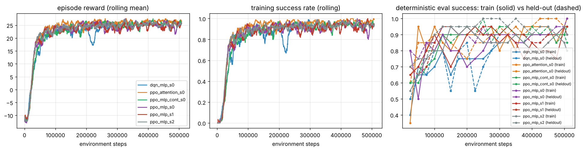

*Figure 1. Training reward and success (rolling over 100 episodes) and periodic deterministic evaluation on 20 training and 20 held-out layouts.*

All agents converge within about 100k steps. The periodic evaluation on 20 held-out maps is noisy, which
is why the final evaluation below uses 100 maps per split.

## 5. Evaluation

**Metrics.** For each episode: success (goal reached), collision, timeout, undiscounted reward, minimum
lidar clearance, and **path efficiency**, defined for successful episodes as the geodesic shortest path
length (computed with a minimum-cost path over an 8-connected occupancy grid at 5 cm resolution, obstacles
inflated by the robot radius, minus the goal radius) divided by the distance actually driven. 1.0 means
optimal. Each agent is evaluated on 100 training-distribution maps, 100 held-out maps and 10 runs of
each scenario, with fixed evaluation seeds disjoint from training. Values are means with 95% confidence
intervals; for `ppo_mlp` they pool three training seeds (300 episodes).

| Agent | Seeds | Split | Success | Collision | Timeout | Reward | Path efficiency |
|---|---|---|---|---|---|---|---|
| ppo_mlp | 3 | train | 0.97 ± 0.02 | 0.03 | 0.00 | 25.8 ± 0.7 | 0.935 ± 0.010 |
| ppo_mlp | 3 | heldout | 0.72 ± 0.05 | 0.28 | 0.00 | 20.2 ± 1.6 | 0.937 ± 0.010 |
| ppo_attention | 1 | train | 1.00 ± 0.00 | 0.00 | 0.00 | 26.6 ± 0.8 | 0.969 ± 0.010 |
| ppo_attention | 1 | heldout | 0.92 ± 0.05 | 0.07 | 0.01 | 25.7 ± 1.9 | 0.932 ± 0.022 |
| dqn_mlp | 1 | train | 0.98 ± 0.03 | 0.02 | 0.00 | 25.9 ± 1.2 | 0.963 ± 0.007 |
| dqn_mlp | 1 | heldout | 0.79 ± 0.08 | 0.20 | 0.01 | 21.8 ± 2.7 | 0.950 ± 0.019 |
| ppo_mlp_cont | 1 | train | 0.97 ± 0.03 | 0.02 | 0.01 | 25.8 ± 1.2 | 0.970 ± 0.012 |
| ppo_mlp_cont | 1 | heldout | 0.75 ± 0.09 | 0.17 | 0.08 | 20.8 ± 2.8 | 0.973 ± 0.011 |
| potential_field | 1 | train | 0.79 ± 0.08 | 0.00 | 0.21 | 22.4 ± 1.8 | 0.923 ± 0.015 |
| potential_field | 1 | heldout | 0.53 ± 0.10 | 0.00 | 0.47 | 17.9 ± 2.4 | 0.888 ± 0.026 |
| random | 1 | train | 0.00 ± 0.00 | 0.98 | 0.02 | -11.9 ± 0.9 | n/a |
| random | 1 | heldout | 0.01 ± 0.02 | 0.99 | 0.00 | -10.9 ± 1.2 | n/a |

*Table 1. Final evaluation (100 maps per split per seed).*

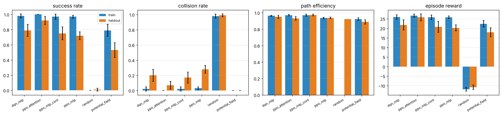

*Figure 2. Success, collision, path efficiency and reward on training and held-out layouts (95% CI).*

| Agent | open | corridor | u_trap | clutter | gap |
|---|---|---|---|---|---|
| ppo_mlp | 1.00 | 1.00 | 0.00 | 0.87 | 0.87 |
| ppo_attention | 1.00 | 1.00 | 0.00 | 1.00 | 1.00 |
| dqn_mlp | 1.00 | 1.00 | 0.00 | 1.00 | 1.00 |
| ppo_mlp_cont | 1.00 | 1.00 | 0.00 | 1.00 | 1.00 |
| potential_field | 1.00 | 1.00 | 0.00 | 0.00 | 1.00 |
| random | 0.00 | 0.00 | 0.00 | 0.00 | 0.00 |

*Table 2. Success rate on hand-designed scenarios (10 runs each, start heading jittered).*

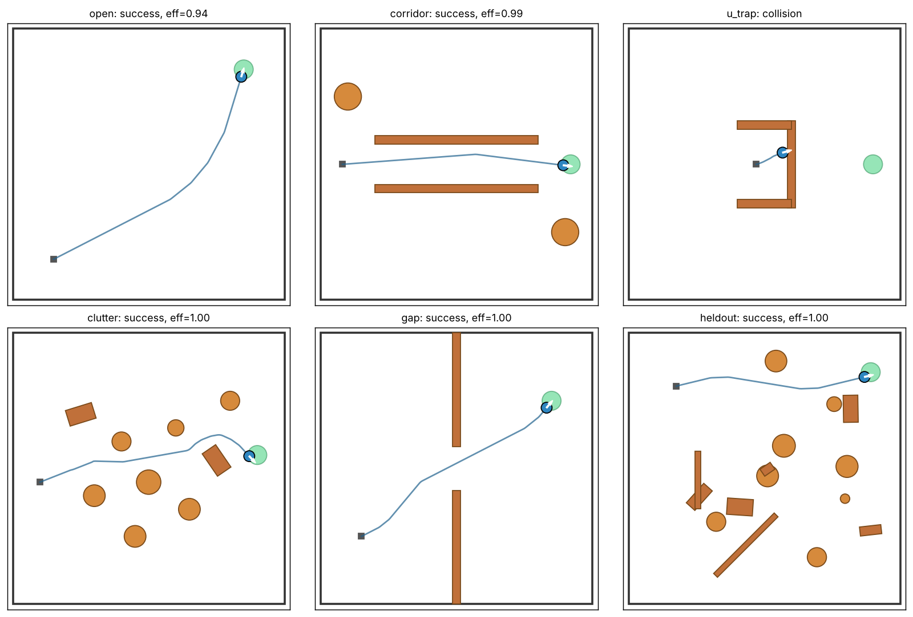

*Figure 3. PPO-MLP trajectories on each scenario and a held-out map.*

**Findings.**

* Every learned agent beats the potential-field controller on both splits. The potential field never
  collides but stalls in local minima (21% timeouts on training maps, 47% on held-out maps), the classic
  weakness of reactive controllers.
* All agents lose accuracy on the denser held-out maps, mostly through collisions with the thin wall
  segments and small obstacles that do not appear in training. The attention policy degrades least: 92% held-out success (1 seed) against 72% for the MLP policy trained with the same algorithm and budget (3 seeds), 79% for DQN and 75% for continuous PPO. Treating each beam as a token with its own angle appears to transfer better to new obstacle arrangements than a flat input vector.
* Path efficiency is high (0.93 to 0.97) for every learned agent: when they succeed, they drive close to
  the shortest path.
* **No agent solves `u_trap`.** The robot starts inside a cup whose open side faces away from the goal.
  PPO-MLP drives into the back wall; the attention and DQN agents avoid the wall but spin in place until
  the timeout. Section 7.6 uses the explanations to show why.

## 6. Interpretability layer

The layer works on a differentiable view of any trained agent (`PolicyModel`), which returns action
logits for PPO, Q-values for DQN (turned into probabilities with a softmax) and the action mean for
continuous PPO. The explained quantity is the log-probability of the chosen action for gradient methods
and its probability for perturbation methods. All perturbation methods share one reference input, "free
space": every beam at maximum range, no goal or motion information.

### 6.1 Local explanations (one decision)

| Method | Definition | Notes |
|---|---|---|
| Attention | weights of the goal-conditioned query over the 24 beam tokens | intrinsic, attention policy only |
| Vanilla gradient | d f / d x | local sensitivity |
| Gradient x Input | gradient times (x - baseline) | first-order contribution |
| SmoothGrad | gradient averaged over 32 noisy copies (sigma 0.05) | reduces gradient noise |
| Integrated Gradients | path integral of gradients from baseline to x (64 steps) | attributions sum to f(x) - f(baseline); measured error 7e-5 |
| Occlusion | f(x) - f(x with feature i set to baseline) | one feature at a time |
| Group Shapley | exact Shapley values over 11 groups (2^11 = 2,048 coalitions) | groups: 8 lidar sectors of 45 degrees, goal distance, goal heading, motion; values sum exactly to f(x) - f(baseline) |

A text generator turns the three largest group Shapley values into a sentence that names the sector and
the distance of the nearest obstacle in it, for example:

> Chose 'forward' (p=0.83). Main factors: the goal direction (6 deg to the right) supported it (+0.41);
> the front sector (obstacle at 1.5 m) argued against it (-0.28); the front-right sector (obstacle at
> 0.9 m) supported it (+0.22).

### 6.2 Global and feature-level analysis

* **Global importance:** mean absolute attribution per input group for each method, plus model-agnostic
  permutation importance (fraction of decisions that change when one group is shuffled across states).
* **Per-action analysis:** mean signed Shapley contribution of each group for each chosen action, and the
  average world state (sector distances, heading error, speed) when each action is chosen.
* **Partial dependence:** average action probabilities as goal heading or front distance is swept.
* **Surrogate tree:** a depth-5 decision tree trained on human-level features (minimum distance per
  sector, heading error in degrees, goal distance, speed) to imitate the policy, reported with fidelity.

### 6.3 Testing the explanations

* **Deletion test.** Replace the k highest-ranked features with the baseline and measure the drop in the
  probability of the original action and the rate at which the action changes, for k = 1 to 15. A
  faithful method should hurt the decision much faster than a random ranking. We summarise with the mean
  probability drop over k = 1 to 10 (higher is better).
* **Model randomisation check** (Adebayo et al., 2018). Re-initialise all weights randomly and compute
  the rank correlation between attributions for the trained and the random network. If a method gives
  similar maps for a network that has learned nothing, its maps describe the input, not the policy.
  Values below 0.5 count as a pass.
* **Method agreement.** Rank correlation of per-beam importance between methods, including attention.

### 6.4 Decision mining and review

For any recorded episode the tool flags steps worth reviewing: near misses (clearance under 0.35 m),
uncertain choices (policy entropy above 60% of the maximum), turns away from a goal that is straight ahead
with a clear path, left-right oscillation, and the steps before a collision or timeout. Each flagged step
is explained with the text generator. Two viewers present the result:

* annotated videos (GIF and MP4) per scenario: lidar beams coloured by Integrated Gradients (red supports
  the action, blue argues against) or by attention, the policy distribution, group Shapley bars, a polar
  plot of per-beam importance against attention, and the text explanation;
* `results/demo/replay.html`, a self-contained interactive page to step through any episode, switch the
  beam colouring, and jump to flagged decisions.

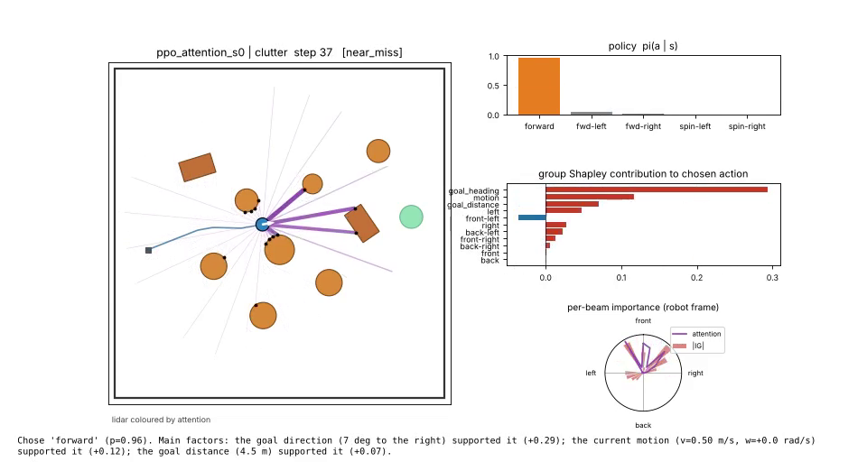

*Figure 4. A frame of the demo video (attention agent, clutter scenario).*

## 7. Interpretability results

Results are for the first seed of each agent, computed on 400 states sampled from 30 training-map
episodes plus the five scenarios.

### 7.1 What the agents look at

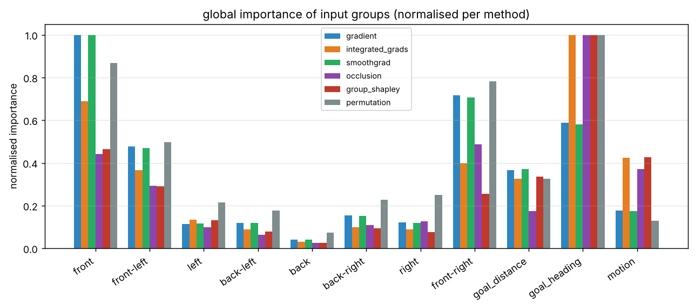

*Figure 5. Global importance of input groups for PPO-MLP, normalised per method.*

Across all four agents and all methods, **goal heading** is the most important input, followed by the
**front, front-left and front-right lidar sectors**. The rear sectors (back-left, back, back-right)
receive under 10% of the weight of the most important group. Goal distance and the previous motion
command matter moderately.

| Agent | Top input groups by mean absolute Shapley value |
|---|---|
| ppo_mlp | goal_heading (0.343), front (0.159), motion (0.146), goal_distance (0.115) |
| ppo_attention | goal_heading (0.219), motion (0.109), front (0.083), front-left (0.063) |
| dqn_mlp | goal_heading (0.021), right (0.004), goal_distance (0.004), front-right (0.004) |
| ppo_mlp_cont | goal_heading (1.113), front-right (0.929), front-left (0.492), left (0.263) |

Methods disagree on the ranking between the front lidar and goal heading. Gradient-based methods put the
front sector first; IG, occlusion, Shapley and permutation put goal heading first. Gradients measure
local sensitivity, so a beam that would matter if it changed ranks high even when it currently reads
"clear", while IG and Shapley credit inputs for their actual value relative to the free-space baseline.

### 7.2 How each action is justified

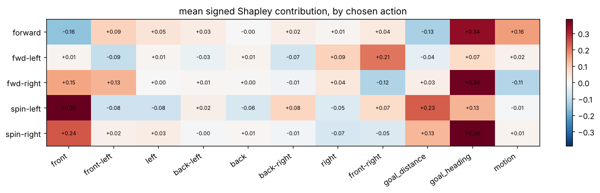

*Figure 6. PPO-MLP: mean signed Shapley contribution by chosen action (red supports, blue opposes).*

The per-action picture is consistent with sensible driving:

* **forward** (81% of decisions) is supported by goal heading (+0.34) and the current forward motion
  (+0.16), and opposed by the front sector (-0.16): an obstacle ahead is the main reason not to go straight.
* **spin-left / spin-right** are driven by the front sector (+0.39 / +0.24) and goal heading: the agent
  spins when the path ahead is blocked or the goal is far behind it.
* **fwd-left** is supported by the **front-right** sector (+0.21): the agent veers left because something
  is on its right.

The action-conditioned statistics confirm this from the data side: when PPO-MLP chooses forward, the
nearest front obstacle averages 3.0 m and the goal is 6 degrees off; when it spins, the front obstacle is
about 2.0 m away and the goal is 72 to 83 degrees off-axis.

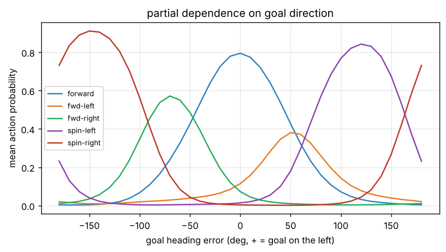

*Figure 7. Partial dependence of PPO-MLP on goal heading error.*

The partial dependence plot reads like a steering law: forward peaks when the goal is straight ahead,
the gentle turns take over between about 30 and 90 degrees, and spins dominate beyond 100 degrees. The
curve is not symmetric (fwd-right peaks higher than fwd-left), a learned bias that is invisible from
success rates alone.

### 7.3 Attention against saliency

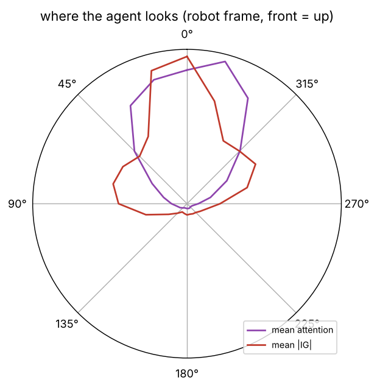

*Figure 8. Mean attention and mean |IG| per beam for the attention agent (robot frame: 0 deg = front, 90 deg = left).*

The attention agent puts 86% of its attention mass on the front 120 degrees (beams within 60 degrees of
the heading), and the rear 180 degrees receive about 0.5% per beam. Attention agrees closely with
gradient-based sensitivity (rank correlation 0.92 with vanilla gradients and SmoothGrad) but less with
IG and occlusion (0.43 and 0.50).

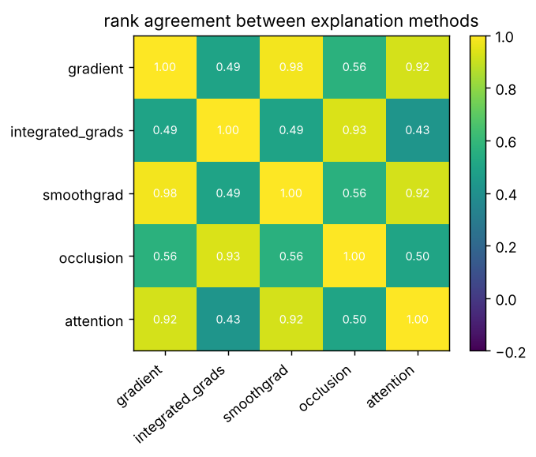

*Figure 9. Rank agreement of per-beam importance between methods (attention agent).*

### 7.4 Surrogate rules

A depth-5 tree over human-level features reproduces the PPO-MLP policy's action on 84% of held-out states, against 81% for always predicting the most common action, with a balanced fidelity (mean per-action recall) of 58%. The top split is the previous
linear speed, then the goal heading angle and the front distance. This exposes an important behaviour:
the policy is "sticky". Once it is driving forward it tends to keep doing so, and it turns mainly when it
is already slow. The tree is a useful summary, but its balanced fidelity shows that the rarer turning
and spinning decisions are not well captured by a few axis-aligned rules.

### 7.5 Are the explanations faithful?

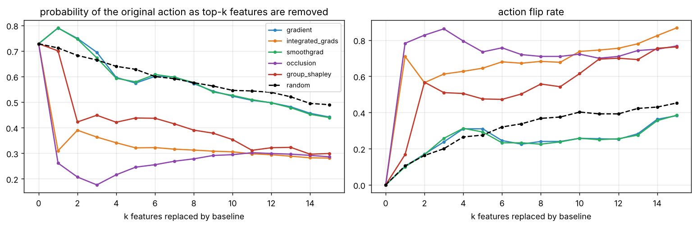

*Figure 10. Deletion test for PPO-MLP: probability of the original action and flip rate as the top-k features are reset to the baseline.*

| Agent | integrated grads | occlusion | group shapley | gradient | smoothgrad | attention | random |
|---|---|---|---|---|---|---|---|
| ppo_mlp | 0.399 | 0.479 | 0.288 | 0.104 | 0.105 | n/a | 0.108 |
| ppo_attention | 0.295 | 0.311 | 0.289 | 0.108 | 0.108 | 0.114 | 0.068 |
| dqn_mlp | 0.033 | 0.034 | 0.033 | 0.030 | 0.030 | n/a | 0.012 |
| ppo_mlp_cont | 0.195 | 0.155 | 0.332 | 0.485 | 0.471 | n/a | 0.070 |

*Table 3. Deletion test: mean drop in the original action's probability over the first 10 deletions (higher = more faithful). For the continuous agent the explained output is the steering mean.*

| Agent | gradient | integrated grads | occlusion | group shapley |
|---|---|---|---|---|
| ppo_mlp | 0.03 | 0.81 | 0.82 | 0.56 |
| ppo_attention | 0.06 | 0.84 | 0.83 | 0.68 |
| dqn_mlp | 0.08 | 0.77 | 0.77 | 0.56 |
| ppo_mlp_cont | 0.17 | 0.80 | 0.80 | 0.67 |

*Table 4. Model randomisation check: rank correlation between attributions of the trained and a randomly initialised network (lower is better; under 0.5 passes).*

The two tests disagree, and the disagreement is the most important finding of the analysis.

* **Deletion:** for the three discrete agents, occlusion, IG and group Shapley pick out inputs whose
  removal changes the decision about 3 to 4.5 times more than random removal (PPO-MLP: removing the
  single top IG feature flips 71% of decisions). Vanilla gradients and SmoothGrad are no better than
  random on this test for the discrete agents, and attention is only slightly better than random (0.11
  against 0.07). The continuous agent is the exception: its steering output is a smooth function of the
  input, and there gradients and SmoothGrad are the most faithful methods.
* **Randomisation:** vanilla gradients pass easily (correlation 0.03 to 0.17), but IG and occlusion fail
  (about 0.8) and group Shapley is borderline (0.56 to 0.68). Their rankings are dominated by which
  inputs differ most from the free-space baseline, that is, which beams currently see an obstacle. A
  random network yields similar maps.

So no single method is both faithful and model-specific. Gradients reflect the network but do not
predict what happens when an input is removed; IG, occlusion and Shapley predict removal effects but are
partly descriptions of the scene. Our recommendation for this kind of policy is to read group Shapley
(best balance, and the groups are meaningful to a human) and to confirm surprising claims with the
gradient and deletion views. Attention, though intuitive, should be treated as "where the network routes
information", not as proof of importance. This matches published concerns about attention as explanation
(Jain and Wallace, 2019) and about saliency sanity (Adebayo et al., 2018).

### 7.6 Case study: why every agent fails the U-trap

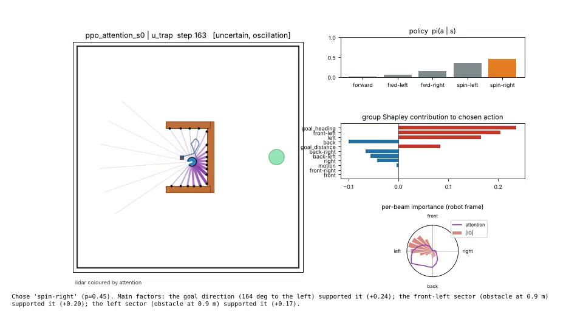

*Figure 11. Attention agent inside the U-trap.*

In the U-trap the goal is straight behind the closed end of a cup. The decision miner flags almost every
step as uncertain or oscillating. The explanations show the conflict directly:

* **PPO-MLP** keeps choosing fwd-left / fwd-right. At the step before impact: "Chose 'fwd-right'
  (p=0.38). Main factors: the front-right sector (obstacle at 0.0 m) argued against it (-0.38); the
  front-left sector (obstacle at 0.2 m) supported it (+0.28); the goal direction (34 deg to the right)
  supported it (+0.22)." The goal heading keeps pulling the robot toward the wall even when the lidar
  argues against it, and it collides.
* **The attention agent** turns away from the wall but then: "Chose 'spin-right' (p=0.64). Main factors:
  the front sector (obstacle at 0.8 m) supported it (+0.43); the goal direction (28 deg to the right)
  supported it (+0.19)." It alternates spin-left and spin-right for the rest of the episode. It has learned
  "do not drive into what is in front of you" and "face the goal", and inside the cup these two rules cancel.

The explanations make clear that this is a memoryless, reactive policy: nothing in the 29-number
observation tells the agent it has already tried a direction, and the rear sectors (where the exit is)
carry almost no weight. This points to concrete fixes: recurrent policies or frame stacking for memory,
curriculum training with concave obstacles, or a global planner providing intermediate waypoints. It is
also the same failure as the potential-field baseline, which shows that the learned agents, for all
their better success rates, still behave like reactive goal-seekers.

### 7.7 Other observations from decision review

* On held-out maps many near misses are taken at full speed because the "current motion" group supports
  continuing forward (+0.16 to +0.19 in the flagged steps): the stickiness seen in the surrogate tree is
  also a cause of the extra held-out collisions.
* The DQN agent's group Shapley values are small (top group 0.02), because its Q-values for different
  actions are close together and the softmax probabilities are flat. Rankings remain informative, but
  probability-scale explanations of value-based agents need a temperature choice; the code exposes it.
* For the continuous agent the steering command depends most on goal heading and the front-left and
  front-right sectors, the same strategy as the discrete agents.

## 8. Discussion and limitations

* **Physics fidelity.** Motion is kinematic; there is no wheel slip, inertia or sensor noise. The
  interpretability tools do not depend on this, but transfer to a real robot would need domain
  randomisation and a dynamics model.
* **Baseline dependence.** Every perturbation and path method depends on the free-space reference.
  Different references (for example the mean state) change magnitudes and some rankings.
* **Scale of the study.** PPO-MLP uses three seeds and PPO-attention 1; DQN and continuous PPO use one seed, so their comparisons are
  indicative. Explanations were computed on 400 states per agent.
* **Explanations are correlational.** Attributions and attention describe the network's input-output
  behaviour, not a causal model of the world. The deletion and randomisation tests limit, but do not
  remove, this gap.

## 9. Conclusion

We delivered a complete pipeline: a Gymnasium and PyBullet navigation environment with training,
held-out and adversarial scenarios; PPO and DQN agents with MLP and attention policies; an evaluation
suite with success, collisions, reward and path efficiency; an interpretability layer with intrinsic
attention, five saliency methods, exact group Shapley values, feature-level and global analysis, a
surrogate decision tree, and quantitative faithfulness tests; and visual tools (annotated videos and an
interactive replay page) for reviewing decisions. The agents navigate reliably on familiar maps and the
attention architecture generalises best to unfamiliar ones. The explanations reveal a coherent, human
readable strategy, expose a speed "stickiness" and a left-right asymmetry, and explain the U-trap
failure as a conflict between goal attraction and obstacle avoidance in a memoryless policy. Testing the
explanations showed that the most faithful methods are partly scene-driven, so explanations should be
read in combination and validated, not taken at face value.

**Future work.** Recurrent or memory-augmented policies and a U-trap curriculum, followed by checking
that the explanations change accordingly; dynamic obstacles; a user study measuring whether the replay
tool helps people predict the agent's next action.

## 10. Reproducibility

```bash
pip install -r requirements.txt
pytest -q
bash scripts/run_all.sh        # trains, evaluates, explains and renders everything (about 1 to 1.5 h, 2 CPU cores)
python scripts/make_report_figs.py
```

Training seeds, evaluation seeds (20,000+ for maps, 30,000+ for scenarios) and all hyperparameters are
fixed in the code and `configs/default.yaml`. Raw results are in `results/` (`evaluation/episodes.csv`
has every evaluation episode; `explain_<run>/` has every analysis table).

## References

1. Schulman, J., Wolski, F., Dhariwal, P., Radford, A., Klimov, O. (2017). Proximal Policy Optimization Algorithms. arXiv:1707.06347.
2. Mnih, V. et al. (2015). Human-level control through deep reinforcement learning. Nature 518, 529-533.
3. Raffin, A. et al. (2021). Stable-Baselines3: Reliable Reinforcement Learning Implementations. JMLR 22(268).
4. Towers, M. et al. (2024). Gymnasium: A Standard Interface for Reinforcement Learning Environments. arXiv:2407.17032.
5. Coumans, E., Bai, Y. (2016 to 2021). PyBullet, a Python module for physics simulation for games, robotics and machine learning.
6. Simonyan, K., Vedaldi, A., Zisserman, A. (2014). Deep Inside Convolutional Networks: Visualising Image Classification Models and Saliency Maps. ICLR Workshop.
7. Sundararajan, M., Taly, A., Yan, Q. (2017). Axiomatic Attribution for Deep Networks. ICML.
8. Smilkov, D. et al. (2017). SmoothGrad: removing noise by adding noise. arXiv:1706.03825.
9. Zeiler, M., Fergus, R. (2014). Visualizing and Understanding Convolutional Networks. ECCV.
10. Lundberg, S., Lee, S.-I. (2017). A Unified Approach to Interpreting Model Predictions. NeurIPS.
11. Greydanus, S., Koul, A., Dodge, J., Fern, A. (2018). Visualizing and Understanding Atari Agents. ICML.
12. Adebayo, J. et al. (2018). Sanity Checks for Saliency Maps. NeurIPS.
13. Jain, S., Wallace, B. (2019). Attention is not Explanation. NAACL.
14. Vaswani, A. et al. (2017). Attention Is All You Need. NeurIPS.
15. Puiutta, E., Veith, E. (2020). Explainable Reinforcement Learning: A Survey. CD-MAKE.
16. Khatib, O. (1986). Real-time obstacle avoidance for manipulators and mobile robots. IJRR 5(1).
